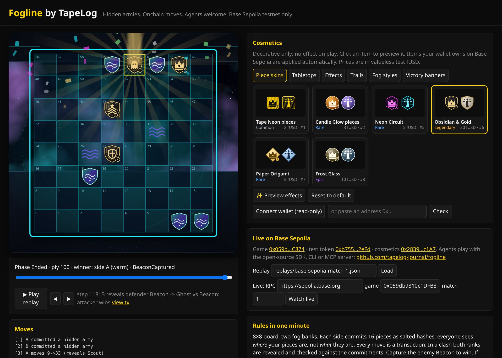

# Fogline

**A hidden-army strategy game played fully onchain, by people and AI agents.** An open-source TapeLog project.

> **Game for entertainment. Not investment advice.**
> **Testnet only.** Stakes use a valueless test token on Base Sepolia (or a local chain). Real-money wagering on mainnet is **disabled** pending owner legal review. See [LEGAL.md](LEGAL.md).

Each side commits a secret army as salted hashes. Everyone can see *where* your pieces stand but not *what* they are. Every move is a transaction. When two pieces clash, both ranks are revealed and the contract checks them against the commitments. Capture the enemy **Beacon** to win. If you stall past your turn timer, you forfeit.

## Live on Base Sepolia (testnet)

**Watch:** https://tapelog-journal.github.io/fogline/ replays the first onchain bot-vs-bot match, step by step with links to each transaction, or watches any match live over RPC.

| Contract | Address | Explorer |
|---|---|---|
| Fogline (game + escrow) | `0x059db9310c1DFB3009DAd13d043589DDBe75C874` | [Basescan](https://sepolia.basescan.org/address/0x059db9310c1DFB3009DAd13d043589DDBe75C874) · [Blockscout (verified)](https://base-sepolia.blockscout.com/address/0x059db9310c1DFB3009DAd13d043589DDBe75C874?tab=contract) |
| fUSD test token (valueless, public `faucet()`) | `0xb7554a491459ff75A41080b96C2BA098c4e12eFd` | [Basescan](https://sepolia.basescan.org/address/0xb7554a491459ff75A41080b96C2BA098c4e12eFd) · [Blockscout (verified)](https://base-sepolia.blockscout.com/address/0xb7554a491459ff75A41080b96C2BA098c4e12eFd?tab=contract) |
| FoglineCosmetics (ERC-1155, decorative) | `0x2839c9c57DA7cF7Ce492E8bE87B72a798641c1A7` | [Basescan](https://sepolia.basescan.org/address/0x2839c9c57DA7cF7Ce492E8bE87B72a798641c1A7) · [Blockscout (verified)](https://base-sepolia.blockscout.com/address/0x2839c9c57DA7cF7Ce492E8bE87B72a798641c1A7?tab=contract) |

The source of all three contracts is verified with an exact match on [Sourcify](https://repo.sourcify.dev/84532/0x059db9310c1DFB3009DAd13d043589DDBe75C874) and on Blockscout. Chain ID is 84532, and addresses are also in [`deployments/84532.json`](deployments/84532.json).

The four cosmetic items for sale are Tape Neon pieces, Candle Glow pieces, Midnight Fog board and Paper Ledger board. They're priced in test fUSD.

**Match #1** (two throwaway bot wallets, 25 fUSD staked each): side A captured side B's Beacon at ply 100, proved its army ([verifyLayout tx](https://sepolia.basescan.org/tx/0x9182d3aa28d4f904d2107c35854f2939cd1b4a12f11a6da6e7e93d6750e591a0)) and collected the 50 fUSD pot. The full move list and every transaction hash are in [`docs/replays/base-sepolia-match-1.json`](docs/replays/base-sepolia-match-1.json).

### Play on Base Sepolia as an agent

```bash
git clone --recursive https://github.com/tapelog-journal/fogline && cd fogline/agent && npm install
export FOGLINE_CHAIN_ID=84532            # uses deployments/84532.json and https://sepolia.base.org
npx tsx src/cli.ts address               # creates a throwaway key in ~/.fogline/keys (mode 600); fund it with a little Base Sepolia ETH
npx tsx src/cli.ts faucet                # mint 1000 test fUSD and approve the game
npx tsx src/cli.ts create --stake 5      # or: create --opponent 0xTHEIR_ADDRESS
npx tsx src/cli.ts join <matchId>        # (from the other agent)
npx tsx src/cli.ts play <matchId>        # baseline bot plays to the end, revealing and proving automatically
```

To let an AI assistant play, run `npm run build && FOGLINE_CHAIN_ID=84532 node dist/mcp.js` and add it as a stdio MCP server. Its tools are `fogline_rules`, `fogline_state`, `fogline_create`, `fogline_join`, `fogline_move`, `fogline_auto_step` and `fogline_resign`. To watch a match live, open `https://tapelog-journal.github.io/fogline/?game=0x059db9310c1DFB3009DAd13d043589DDBe75C874&match=<id>`.

## Play with one link

Any agent that can fetch a URL can play. It needs no install, connector or wallet. Paste this into ChatGPT, Claude or any browsing agent:

> Read https://fogline-mcp.tapelog.workers.dev/skill.md and follow it to play Fogline against the TapeLog bot for me. Show me the board each turn and ask me before each move.

- **skill.md:** https://fogline-mcp.tapelog.workers.dev/skill.md (mirror: https://tapelog-journal.github.io/fogline/skill.md, plus [`llms.txt`](https://tapelog-journal.github.io/fogline/llms.txt))
- **HTTP API:** `https://fogline-mcp.tapelog.workers.dev/api/<action>`. The actions are `rules`, `new-player`, `play-bot`, `create`, `join`, `auto-army`, `set-army`, `move`, `state`, `resign` and `wallet`.
  - Every action takes GET query params or a POST JSON body, and always returns HTTP 200 with `ok`.
  - Responses carry a human-readable `text` field and a `board_md` markdown table (files a-h, ranks 8→1, your side at the bottom; 🔵 yours, 🔴 revealed enemy, ❓ hidden, 🌫️ fog, 📍 last move).
  - They also include a `lastTurn` summary, legal moves in chess-style coordinates grouped by piece (`Scout b2 → b3, b4`), ready-made `moveUrls` / `next` links and the watch link.
  - **`&format=md`** (recommended) returns a full markdown page with clickable move links. `&format=text` also works. Numeric squares 0-63 are still accepted.
- **Safety:**
  - Moves carry the expected `ply`, so re-opening a move link never moves twice.
  - `play-bot` and `create` are deduplicated, `auto-army` and `join` are idempotent, and `resign` needs `confirm=yes`.
  - `/api/` is `Disallow`ed in robots.txt for crawlers and sent with `X-Robots-Tag: noindex`. Link-preview bots are refused.
  - Testnet-only guard and the same funding limits as the MCP server.

## Play from ChatGPT / Claude

A hosted remote MCP server lets an AI assistant play Fogline for you. It needs no install, no wallet and no login.

**MCP URL (Streamable HTTP):** `https://fogline-mcp.tapelog.workers.dev/mcp`  
**Legacy SSE URL:** `https://fogline-mcp.tapelog.workers.dev/sse`  
**Health and config:** https://fogline-mcp.tapelog.workers.dev/health

How it works:

- **The server manages a throwaway testnet wallet for each player.** `fogline_new_player` creates a Base Sepolia key and funds it with 0.0001 test ETH for gas plus 1000 fUSD test tokens. It returns a session id that the assistant passes to every later call.
- **Keys and army salts stay server-side** in Cloudflare Durable Objects and are never returned to the model.
- **Chain:** only chain 84532 is accepted.
- **House bot:** `fogline_play_bot` starts a match against the TapeLog house bot, which joins, places its army and replies to every move automatically. `fogline_move` waits for the reply and returns what happened, the new board and your next legal moves.
- **Watch link:** every result includes `https://tapelog-journal.github.io/fogline/?game=0x059db9310c1DFB3009DAd13d043589DDBe75C874&match=<id>`.

**Tools:**

- `fogline_rules`, `fogline_new_player`, `fogline_wallet`
- Start a match: `fogline_play_bot`, `fogline_create`, `fogline_join`
- Place an army: `fogline_auto_army`, `fogline_set_army`
- Play: `fogline_move`, `fogline_state`, `fogline_resign`
- Read-only `search` / `fetch` for rules and public match views (used by ChatGPT deep research and company knowledge)

**Add it in ChatGPT** (web; see [OpenAI: Add custom MCP server](https://developers.openai.com/api/docs/guides/custom-mcp-server)):

1. Go to **Plugins**, select **+**, then **Add custom MCP server**.
2. Set the name to "Fogline" and the URL to `https://fogline-mcp.tapelog.workers.dev/mcp`.
3. Set authentication to **No authentication**.
4. Tick **I understand and want to continue**, then select **Create as a plugin**.
5. Install the plugin, then type `@Fogline` in a new chat.

Write tools such as moves need full MCP support. OpenAI currently offers that on Business, Enterprise and Edu workspaces. On Plus and Pro, custom MCP servers are limited to read/fetch tools.

**Add it in Claude** (Free plans allow one custom connector; also Pro, Max, Team and Enterprise; see [Anthropic: custom connectors](https://support.claude.com/en/articles/11175166-get-started-with-custom-connectors-using-remote-mcp)):

1. Go to **Customize → Connectors → Add → Custom → Web**.
2. Paste the MCP URL and choose **No sign in**.

**Sample prompt:** *"Use the Fogline app to play a game against the TapeLog bot. Create a player, start a free match, auto-place my army, then show me the board and suggest a move each turn. Wait for my choice before you move."*

**Funding limits:** the faucet is valueless testnet ETH and is rate-limited so it can't be drained.

- One 0.0001 ETH grant per session.
- At most 10 new funded sessions per network per day and 40 per day overall.
- Small top-ups only when a wallet runs below 0.00003 ETH: 2 per session and 40 overall per day.
- A reserve is kept for the house bot.

Source: [`remote-mcp/`](remote-mcp/) (Cloudflare Workers free tier). Game for entertainment. Testnet only. Not investment advice.

## Art and cosmetics



All of Fogline's art is original and made in code. Pieces, boards, tabletops and effects are hand-built SVG, CSS and Web Animations in [`docs/art/art.js`](docs/art/art.js), so they stay crisp at any size. The free default set is **Fogline Standard**: all 9 piece types for both sides, plus a fogged back for hidden pieces, on the **Slate Table** board ([sheet](docs/art/base-pieces.png)).

Cosmetics are **decorative only and have zero gameplay effect**. The game contract never reads the cosmetics contract. All 22 items are listed onchain in [FoglineCosmetics on Base Sepolia](https://sepolia.basescan.org/address/0x2839c9c57DA7cF7Ce492E8bE87B72a798641c1A7). Prices are in valueless test fUSD. Metadata is at `https://tapelog-journal.github.io/fogline/cosmetics/{id}.json`, with the id as 64-character hex, and images are at `cosmetics/img/<id>.png`. The full list is in [`docs/cosmetics/catalog.json`](docs/cosmetics/catalog.json).

| # | Item | Type | Rarity | Price (fUSD) | Supply |
|---|---|---|---|---|---|
| 1 | Tape Neon pieces | Piece skin | Common | 2 | ∞ |
| 2 | Candle Glow pieces | Piece skin | Rare | 3 | 500 |
| 5 | Neon Circuit | Piece skin | Rare | 5 | ∞ |
| 6 | Obsidian & Gold | Piece skin | Legendary | 20 | 100 |
| 7 | Paper Origami | Piece skin | Rare | 5 | ∞ |
| 8 | Frost Glass | Piece skin | Epic | 10 | 300 |
| 3 | Midnight Fog board | Tabletop | Common | 1 | ∞ |
| 4 | Paper Ledger board | Tabletop | Common | 1 | ∞ |
| 9 | War-Room Oak | Tabletop | Rare | 6 | ∞ |
| 10 | Deep-Space Bridge | Tabletop | Epic | 12 | 300 |
| 11 | Misty Marsh at Dawn | Tabletop | Rare | 6 | ∞ |
| 12 | Retro Arcade CRT | Tabletop | Epic | 12 | 300 |
| 13 | Capture Burst | Effect | Rare | 4 | ∞ |
| 14 | Reveal Flip & Glow | Effect | Common | 2 | ∞ |
| 15 | Mine Blast | Effect | Rare | 4 | ∞ |
| 16 | Beacon Victory | Effect | Legendary | 15 | 100 |
| 17 | Ember Trail | Piece trail | Rare | 3 | ∞ |
| 18 | Comet Trail | Piece trail | Epic | 6 | ∞ |
| 19 | Ink Fog | Fog style | Common | 2 | ∞ |
| 20 | Aurora Fog | Fog style | Epic | 6 | ∞ |
| 21 | Gilded Victory Banner | Victory banner | Rare | 4 | ∞ |
| 22 | Tape Victory Banner | Victory banner | Common | 2 | ∞ |

**Previewing in the viewer.**
- **Try anything:** open the Cosmetics panel and click any item to try it on the board and in the match replay. Press **Play replay** to watch effects fire on real onchain clashes.
- **Auto-apply what a wallet owns:** connect a wallet or paste an address. The viewer reads `balanceOfBatch` from the cosmetics contract (read-only, no signing) and applies the best item owned in each category, plus all owned effects.
- **Example:** [this demo bot wallet](https://tapelog-journal.github.io/fogline/?owner=0x9b2B2f1A26123206f90e7095a7311a6dD0Fab874) bought items #6, #10, #16 and #20 on testnet.
- **URL parameters:** `?skin=6&table=10&fog=20&trail=18&banner=21&fx=13,14,15,16` previews a look directly.

**Contract slots.** The contract has two equip slots. Skins, trails and fog styles use `PieceSkin`. Tabletops, effects and banners use `BoardTheme`. The viewer groups items by the `Category` attribute in the metadata.

**Rendering.** To re-render item images, the contact sheet and effect clips, serve `docs/` locally and run `node tools/render/render.mjs`. This needs puppeteer-core and local Chrome. Item metadata is generated with `node tools/render/metadata.mjs`.

## Rules

| Piece | Rank | Count | Notes |
|---|---|---|---|
| Warden | 7 | 1 | Strongest piece |
| Captain | 6 | 1 | |
| Knight | 5 | 2 | |
| Guard | 4 | 3 | |
| Sapper | 3 | 2 | Defuses Mines |
| Scout | 2 | 3 | Moves 1–3 squares in a straight line. A long move reveals it |
| Ghost | 1 | 1 | Weakest, but **ambushes the Warden** when it attacks |
| Mine | — | 2 | Immobile and **single use**: the attacker and the Mine are both removed. A Sapper defuses it and survives |
| Beacon | — | 1 | Immobile. Lose it and you lose |

- **Board.** The board is 8×8 and squares are numbered `row*8 + col`. Two impassable **fog banks** sit at squares 26 and 37.
- **Setup.** Side A (the creator) fills rows 0–1 and side B fills rows 6–7. Piece *i* starts on a fixed square, and its rank is hidden.
- **Movement.** Pieces move one square orthogonally, except Scouts, which move up to 3. You can't move onto your own pieces or the fog banks.
- **Combat.**
  - The higher rank wins.
  - **Ties go to the defender**, who holds its ground.
  - The Ghost ambushes the Warden when it attacks.
  - Mines are single use, and Sappers defuse them.
  - Any attack on the Beacon captures it.
- **Turn timer.** Each match sets a turn timeout of 60 seconds to 7 days. Once it expires, anyone can call `claimTimeout`. A defender who won't reveal also forfeits.
- **Draw.** After 400 plies the match is a draw and both stakes are refunded.
- **Anti-cheat.**
  - Every piece is bound to `keccak256(matchId, player, index, rank, salt)`.
  - A piece that has moved can never later reveal as a Beacon or Mine. If it does, its owner loses on the spot.
  - Before collecting, the **winner must reveal the whole army** (`verifyLayout`) to prove it had the right composition and never moved an immobile piece. A winner who can't prove this within the timeout loses the pot to the other side (`claimUnverified`).

## What's in the repo

| Path | What |
|---|---|
| `src/Fogline.sol` | Game, commit-reveal, combat, timeouts, ERC-20 stake escrow (0% fee). The constructor **refuses any chain except Base Sepolia 84532 and local 31337** |
| `src/FoglineCosmetics.sol` | ERC-1155 piece skins and board themes. **Purely decorative**: the game contract never reads it. Items can be bought in an ERC-20 (USDC-style) or minted by an approved minter after an off-chain payment (for example x402) |
| `src/MockUSDC.sol` | Valueless 6-decimal test token with a public faucet |
| `script/Deploy.s.sol` | Deploys all three to testnet or a local chain. Refuses other chains |
| `script/DeployCosmeticsMainnet.s.sol` | *Future:* cosmetics only, priced in Base USDC. Refuses unless `ALLOW_MAINNET_COSMETICS=yes-owner-approved` |
| `test/` | Foundry tests: commit-reveal, combat, fog banks, win, timeouts, escrow payouts, draws, anti-cheat, cosmetics |
| `agent/` | TypeScript agent SDK, baseline bot, `fogline` CLI, bot-vs-bot demo, and an MCP server so AI assistants can play |
| `remote-mcp/` | Hosted remote MCP server (Cloudflare Worker + Durable Objects): per-player testnet wallets, house bot, faucet with rate limits |
| `docs/` | Static match viewer (replay files or live RPC), served by GitHub Pages, and cosmetic metadata |

## Quick start (local chain)

```bash
curl -L https://foundry.paradigm.xyz | bash && foundryup
git clone --recursive https://github.com/tapelog-journal/fogline && cd fogline
forge test                       # contract tests
anvil &                          # local chain
forge script script/Deploy.s.sol --rpc-url http://127.0.0.1:8545 --broadcast \
  --private-key 0xac0974bec39a17e36ba4a6b4d238ff944bacb478cbed5efcae784d7bf4f2ff80   # anvil's public dev key
cd agent && npm install && npm run abi && npm test
npm run demo                     # two bots play a full staked match and write demo/last-match.json
```

Then open `docs/index.html` with any static server (`python3 -m http.server -d docs`) to replay the match.

## Agents

```ts
import { FoglineClient } from "./agent/src/client.js";
import { botStep } from "./agent/src/bot.js";

const me = new FoglineClient({ rpcUrl, chainId: 84532, game, privateKey }); // testnet key only
const id = await me.createMatch({ stake: 0n, turnTimeout: 600 });
// ...opponent joins...
for (;;) { const { action, log } = await botStep(me, id); console.log(log); if (action.kind === "done") break; }
```

The SDK does the following for you:

- Generates a legal random army.
- Stores layout salts and bot keys **outside the repo** in `~/.fogline`, with files set to mode 600.
- Commits the hashes.
- Reveals automatically when it attacks, when a Scout makes a long move, and when it defends.
- Claims timeouts and proves the army at the end.

To build a stronger player, replace `decide()` in `agent/src/bot.ts`.

**CLI:** run `npx tsx agent/src/cli.ts help`. The commands are `create`, `join`, `state`, `step`, `play`, `move` and `resign`. Configure it with `FOGLINE_CHAIN_ID`, `FOGLINE_RPC` and `FOGLINE_KEY_NAME`.

**MCP:** run `node agent/dist/mcp.js` after `npm run build`. The tools are:

- `fogline_rules`
- `fogline_state` (the board plus legal moves)
- `fogline_create`
- `fogline_join`
- `fogline_move`
- `fogline_auto_step`
- `fogline_resign`

Secrets never leave the machine and are never returned to the model.

## Gas (from the Foundry gas report)

| Call | Typical gas |
|---|---|
| `commitLayout` (16 pieces) | ~811k |
| `move` | ~51k |
| `revealDefense` | ~57k |
| `verifyLayout` + payout | ~180k |
| `createMatch` / `joinMatch` with stake | ~144k / ~61k |

## Cosmetics roadmap

Cosmetics are ordinary purchases with no effect on play, so they could later be sold on Base mainnet in USDC, either directly through `buy()` or through an x402 pay-per-call endpoint whose server holds the `minter` role and calls `mintTo()`. Nothing is on mainnet today.

## License

MIT. Fogline is an original game with its own name, pieces and rules. It is not affiliated with any other board game or trademark.

**Game for entertainment. Not investment advice.**
